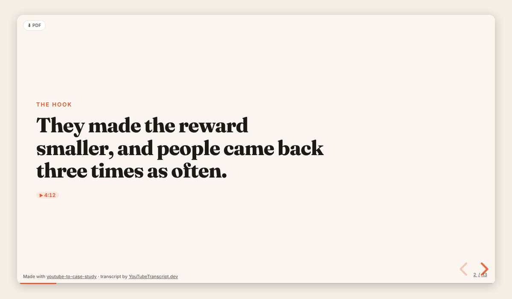
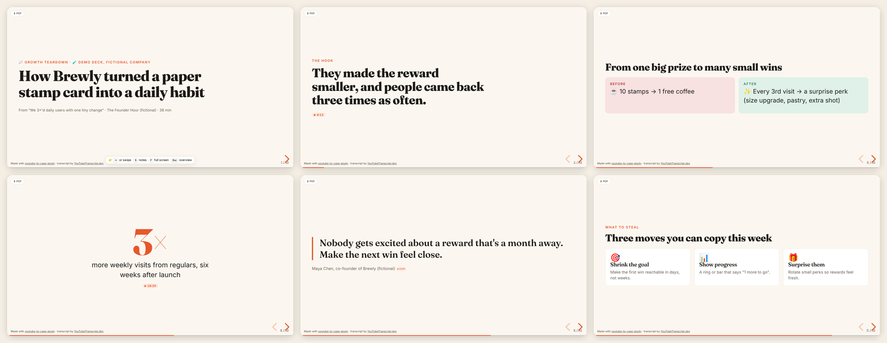

<div align="center">

# 📊 YouTube to Case Study

### Turn any YouTube video into a beautiful case-study slideshow. In one prompt. No coding.

[](LICENSE)
[](#-get-started-in-60-seconds)
[](#-get-started-in-60-seconds)



**Paste a YouTube link → get a presentation-ready case study** 💼 📣 🧭 📈
<br>Founder interviews, product teardowns, conference talks, podcasts, marketing breakdowns: they all become a story with receipts.

</div>

---

## ✨ What you get

One HTML file that opens in any browser. No PowerPoint, no Canva, no account.

| | |
|---|---|
| 📖 **A story, not a summary** | Situation → problem → the clever move → results → lessons |
| 🎯 **4 case-study styles** | 💼 Business · 📣 Marketing · 🧭 UX / Product · 📈 Growth teardown |
| ⏱️ **Timestamp receipts** | Every number and quote links to the exact second in the video |
| 🎨 **Slides that look designed** | Big numbers, pull quotes, before/after, step-by-step, "what to steal" cards |
| 🎤 **Speaker notes** | Press **S** for a presenter view with talking points |
| 🤔 **Discussion & quiz slides** | Perfect for classes, workshops, and team meetings |
| ⬇️ **PDF export** | One click to save or email |
| 🌗 **Light & dark mode** | And it works on phones (swipe to flip) |
| 🛡️ **Honest by design** | The AI's own opinions get an "Analysis" badge, never passed off as fact |



👉 **[See the full example deck](examples/brewly-growth-teardown.html)** (download it and open in your browser). It's a growth teardown of *Brewly*, a fictional coffee app, showing every slide type.

---

## 🚀 Get started in 60 seconds

### Option 1: Claude Code (desktop app, web, or terminal) ⭐ recommended

Type this into Claude Code:

```
/plugin install youtube-to-case-study --marketplace tstfully/youtube-to-case-study
```

That's it. 🎉 This also gives you access to the companion skills ([course](https://github.com/tstfully/youtube-to-course) and [AI chat](https://github.com/tstfully/youtube-to-ai-chat)).

<details>
<summary>Other ways to install</summary>

**Ask Claude to do it.** Paste this into Claude Code (or any coding agent):

> Install the youtube-to-case-study skill from https://github.com/tstfully/youtube-to-case-study, then help me connect a free YouTubeTranscript.dev API key without me pasting the key into this chat.

**Two-step plugin install** (older Claude Code versions):

```
/plugin marketplace add tstfully/youtube-to-case-study
/plugin install youtube-to-case-study@youtube-skills
```

**Skills CLI** (works with Claude Code, Cursor, Codex, and other agents):

```bash
npx skills add tstfully/youtube-to-case-study
```

**Manual:**

```bash
git clone https://github.com/tstfully/youtube-to-case-study ~/.claude/skills/youtube-to-case-study
```

</details>

### Option 2: Claude.ai (no install at all)

1. Click the green **Code** button above → **Download ZIP**.
2. In Claude.ai, go to **Settings → Capabilities → Skills → Upload skill** and choose the ZIP.
3. Grab a transcript for free at [youtubetranscript.dev/tools/transcript](https://www.youtubetranscript.dev/tools/transcript), paste it into the chat, and ask for a case study.

### 🔑 Connect transcripts (free, once)

The skill reads the video's transcript. Pick whichever is easiest:

| | How | Best for |
|---|---|---|
| 📋 **Paste it** | Copy a transcript from the [free tool](https://www.youtubetranscript.dev/tools/transcript) and paste it in | Trying it out, Claude.ai |
| 🔑 **API key** | Get a free key at [youtubetranscript.dev](https://youtubetranscript.dev) (**Dashboard → API Keys**) and save it as `YOUTUBETRANSCRIPT_API_KEY`. Claude can walk you through it. | Using it often |
| 🔌 **MCP server** | `claude mcp add --transport http youtubetranscript https://mcp.youtubetranscript.dev --header "x-api-token: YOUR_API_KEY"` | Claude Code, Claude Desktop, Cursor |

The free plan includes **10 videos a month**, no credit card. Videos without captions can be transcribed from the audio too.

> 🔒 **Never paste an API key into a chat**, a screenshot, or a shared doc. Type it into your settings yourself.

---

## 💬 Just ask

Copy, paste, and swap in your link:

| You are… | Try this |
|---|---|
| 📣 **A marketer** | *"Make a marketing case study from this launch video for my team: [link]"* |
| 🍎 **An educator** | *"Turn this founder interview into a business case study for my MBA class, with discussion questions: [link]"* |
| 🧭 **A product manager** | *"UX case study of this onboarding teardown. What should our team steal? [link]"* |
| 🎓 **A student** | *"I need a business case study on this company for class. Use this video: [link]"* |
| 💼 **A consultant** | *"Client-ready case study from this keynote, with a recommendation slide: [link]"* |
| ✍️ **A creator** | *"8-slide growth teardown for LinkedIn, plus the post copy: [link]"* |

**Bonus asks:** 🔁 *"Re-cut it as a marketing case study"* · ✍️ *"Write the LinkedIn post"* · 🎤 *"Turn the notes into a full speaker script"* · 📧 *"Give me a 3-bullet Slack summary"*

### 🎤 Presenting

| Key | Does |
|---|---|
| **→** / Space / swipe | Next slide |
| **S** | Speaker notes |
| **F** | Full screen |
| **Esc** | Slide overview |
| **⬇ PDF** button | Save as PDF |

---

## 🧩 Which case study style?

| Style | Great for videos about… | The story arc |
|---|---|---|
| 💼 **Business** | strategy, pivots, pricing, a company's rise or fall | Situation → Complication → Decision → Outcome → Lessons |
| 📣 **Marketing** | campaigns, launches, brands, positioning | Goal → Audience → Insight → Big Idea → Execution → Results |
| 🧭 **UX / Product** | flows, features, redesigns, research | Problem → Users → Research → Design Moves → Before/After → Impact |
| 📈 **Growth teardown** | funnels, paywalls, streaks, referral loops | The Hook → The Funnel → The Psychology → What to Steal |

Don't know which? Don't worry: the skill picks the best fit and tells you.

---

## ❓ FAQ

<details>
<summary><b>Do I need to know how to code?</b></summary>
Nope. You type a request in plain English and get a file you double-click to open.
</details>

<details>
<summary><b>Is it really free?</b></summary>
The skill is free and open source (MIT). Transcripts are free for 10 videos a month on YouTubeTranscript.dev, or free anytime if you paste the transcript yourself. You need Claude (Claude.ai, Claude Code, or another AI agent) to run it.
</details>

<details>
<summary><b>Will it make things up?</b></summary>
It's built not to. Every number and quote must come from the transcript and links to its timestamp so you can check it. The AI's own interpretation is labeled "Analysis".
</details>

<details>
<summary><b>Can I edit the slides?</b></summary>
Yes: ask Claude ("make slide 4 punchier", "add a slide about pricing"). The file is plain HTML, so anyone technical can edit it directly too.
</details>

<details>
<summary><b>Can I get it as PowerPoint or Google Slides?</b></summary>
Click <b>⬇ PDF</b> to save a PDF, which imports into both. The live HTML version keeps the clickable timestamps.
</details>

<details>
<summary><b>What languages work?</b></summary>
Any video with captions in 100+ languages. Ask for the deck in your language: "make it in Spanish".
</details>

---

## 🤖 For AI agents

If you are an AI agent helping a user with this repo:
- **Install (Claude Code):** `/plugin install youtube-to-case-study --marketplace tstfully/youtube-to-case-study`, or copy this folder to `~/.claude/skills/youtube-to-case-study`.
- **Entry point:** [`SKILL.md`](SKILL.md). Follow it step by step.
- **Transcript:** use the `youtubetranscript` MCP server if connected, else `scripts/fetch-transcript.mjs` with `YOUTUBETRANSCRIPT_API_KEY`, else ask the user to paste one from https://www.youtubetranscript.dev/tools/transcript. Never ask for API keys in chat.
- **Summary for LLMs:** [`llms.txt`](llms.txt)

<details>
<summary>📁 What's inside</summary>

```
youtube-to-case-study/
├── SKILL.md                         # Step-by-step instructions the AI follows
├── assets/template.html             # Slide template with the full design system
├── references/
│   ├── case-study-frameworks.md     # Business, Marketing, UX, Growth story arcs
│   └── slide-patterns.md            # Every slide type, ready to fill in
├── scripts/fetch-transcript.mjs     # Fetches transcripts (no dependencies)
├── examples/                        # Finished example deck
├── llms.txt                         # Summary for AI agents and search
└── .claude-plugin/                  # One-command install for Claude Code
```

</details>

---

## 💛 More free YouTube skills

| | |
|---|---|
| 🎓 [**youtube-to-course**](https://github.com/tstfully/youtube-to-course) | Turn any video into an interactive course with quizzes and flashcards |
| 💬 [**youtube-to-ai-chat**](https://github.com/tstfully/youtube-to-ai-chat) | Chat with any video, with answers cited to the second |

**Powered by [YouTubeTranscript.dev](https://youtubetranscript.dev):** YouTube transcripts in 100+ languages, AI transcription for videos without captions, and [free tools](https://www.youtubetranscript.dev/tools) with no login.

<sub>MIT licensed · Slides rendered with [reveal.js](https://github.com/hakimel/reveal.js) (MIT) · ⭐ Star the repo if it helped you!</sub>
